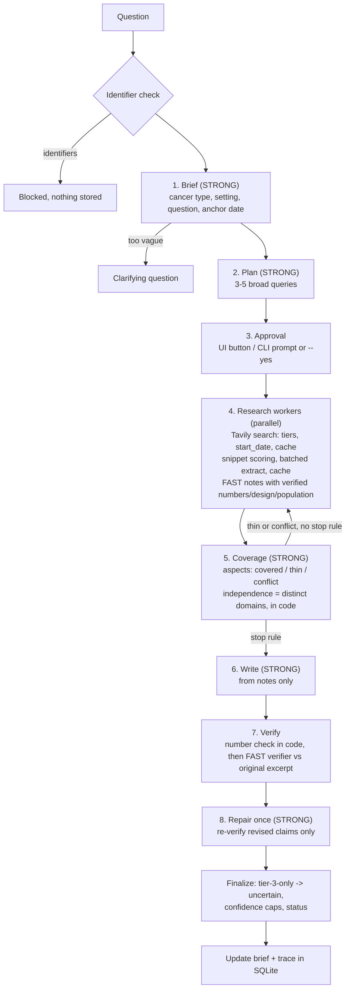

# Oncology Update Briefs

**What has changed for this clinical question since a given date?** This research agent turns an oncologist's question into a dated update brief they can read in under five minutes and verify in seconds. Every claim cites a source excerpt, every number is shown beside the verbatim sentence it came from, and a verifier model checks each claim against the original text.

Built for the Nebius hackathon. It uses [Nebius Token Factory](https://tokenfactory.nebius.com) for all LLM inference and [Tavily](https://tavily.com) `search` + `extract` for live web evidence.

> **Clinician-support tool.** This brief summarizes published and public information to support a clinician's professional judgment and independent review. It is not for patients and does not give patient-specific recommendations.
>
> **Use limits:**
> - clinician-facing only
> - not for patients
> - not for urgent or time-critical decisions
> - does not use patient data
> - summarizes published and public information for independent review

## Who it's for and the task

The user is a practicing oncologist. A guideline was last updated, or a major paper came out, on some date, and they need to know what has changed since then for one clinical question. For example: first-line EGFR-mutant metastatic NSCLC since the 2024 ESMO update, or HER2-low metastatic breast cancer since June 2025.

The output is a dated brief:

1. **Bottom line:** one sentence, with confidence (high, moderate or low) and the reason for it.
2. **What's new since [anchor date]:** one item per development, newest first. Each item shows:
   - the date and source type
   - what changed
   - the evidence level in plain words (e.g. "phase 3 randomized trial")
   - whether it is peer-reviewed or **PRELIMINARY**, labeled in the item itself
   - the study population, or "population not stated"
   - key numbers, each beside its verbatim source sentence
   - the source links with their verdicts
3. **Sources disagree:** conflicts, and how the sources differ.
4. **Not yet established:** aspects with insufficient evidence.
5. **Check before acting:** e.g. full publication pending, label wording, guideline version.
6. **The clinician-support statement.**

### Why live web evidence complements PubMed-based tools

PubMed-based tools are strong on indexed, peer-reviewed literature. Many decision-relevant changes in oncology appear on the web first, or never appear in PubMed at all:

- regulatory approvals, label changes and safety communications (FDA, EMA)
- guideline updates (NCCN, ESMO, ASCO)
- conference abstracts and trial readouts
- trial status changes (ClinicalTrials.gov)
- company announcements

This agent searches those sources first, filtered to on or after the anchor date. It labels anything preliminary as preliminary, so it adds to a PubMed workflow rather than replacing it.

## Setup

Requires Python 3.11+ and [uv](https://docs.astral.sh/uv/).

```bash
uv sync
cp .env.example .env        # fill in NEBIUS_API_KEY and TAVILY_API_KEY
uv run python scripts/list_models.py   # confirm the STRONG and FAST model IDs exist
```

`list_models.py` prints every Token Factory model ID and marks the configured STRONG and FAST models `OK` or `NOT FOUND`, with similar IDs suggested. Set `RESEARCH_STRONG_MODEL` and `RESEARCH_FAST_MODEL` in `.env`, or edit `config.py`, before relying on them. **Keys are read only from the environment and are never logged or printed.**

## Run

```bash
# CLI: shows the brief and planned queries, asks to start (or pass --yes)
uv run research "What has changed for first-line EGFR-mutant metastatic NSCLC since 2024-06-01?"
uv run research "..." --yes --export ris --out sources.ris
uv run research --run 12                      # approve a prepared task later
uv run research --show 12                     # reprint a stored brief

# Web UI
uv run streamlit run app/streamlit_app.py
```

**CLI exit codes:**

| Code | Meaning |
|---|---|
| 0 | done |
| 1 | failed |
| 2 | missing keys |
| 3 | insufficient evidence |
| 4 | needs clarification |
| 5 | not approved |
| 6 | identifiers detected |

**UI:**
- a question box with the no-identifiers notice
- the brief and planned queries, with a **Start research** button
- live progress: the run happens in a background thread and the page polls SQLite, so a refresh doesn't interrupt it
- the brief with verdict, claim-type, tier and PRELIMINARY badges
- numbers beside their source sentences
- clickable sources, CSV and RIS downloads, credit and token totals
- an expandable trace showing the model ID and prompt version for every step

**Tests and evals:**

```bash
uv run pytest                    # mocked unit tests, no network
uv run pytest -m live -s         # optional live smoke test (skipped without keys)
uv run python evals/run_evals.py # 15 questions, live
uv run python evals/compare.py   # drift gate against evals/baseline.json
```

## Deploy to the cloud (container on a VM, e.g. Nebius AI Cloud)

One image runs the Streamlit UI. The same image has the `research` CLI, and both share one SQLite database on a persistent volume, so run history survives restarts and redeploys.

**1. Create a VM.**
- An Ubuntu CPU instance with a public IP and your SSH key is enough, because all inference runs on Token Factory.
- Open ports 22, 80 and 443.
- Install Docker Engine with the Compose plugin.

**2. Get the code and configure it.**
```bash
git clone https://github.com/Gnana-Shishir-Kumar/gauss-jordan.git && cd gauss-jordan
cp .env.example .env    # set NEBIUS_API_KEY, TAVILY_API_KEY, APP_PASSWORD (+ DOMAIN for HTTPS)
```
`APP_PASSWORD` is required: compose refuses to start the app without it. Keys are read from `.env` at runtime and are never put into the image.

**3. Start it.**
```bash
docker compose up -d --build                   # UI on the VM at 127.0.0.1:8501 only
docker compose --profile https up -d --build   # plus Caddy: https://$DOMAIN with an automatic certificate
```
- **Without a domain:** reach the UI through an SSH tunnel. Run `ssh -L 8501:localhost:8501 user@VM_IP`, then open http://localhost:8501.
- **With a domain:** point its DNS A record at the VM and use the `https` profile. Caddy terminates TLS and proxies to the app.
- **Either way,** the app asks for `APP_PASSWORD` once per browser session.

**4. Use the CLI on the VM** (same database as the UI, so `--show` works on runs started in the browser):
```bash
docker compose exec app python scripts/list_models.py
docker compose exec app research "What has changed for first-line EGFR-mutant metastatic NSCLC since 2024-06-01?"
docker compose exec app research --show 3 --export ris --out /data/task3.ris
docker compose cp app:/data/task3.ris .
```

**Operations:**
| Task | Command |
|---|---|
| Update | `git pull && docker compose up -d --build` |
| Logs | `docker compose logs -f app` |
| Back up history | `docker compose cp app:/data/research.db ./backup.db` |

The image runs as a non-root user and has a health check on `/_stcore/health`.

## Architecture



- **Engine** (`src/research_agent/engine/`): plain async functions, one per step (`brief`, `planner`, `research`, `coverage`, `writer`, `verifier`), plus `checks` (the deterministic guards) and the `orchestrator`. The orchestrator exposes `prepare()` (brief and plan, then it stops for approval), `run()` (everything after approval) and `run_all()`. There is no UI code in the engine, so a FastAPI wrapper could call these functions as they are.
- **Backends** (`backends/`): `llm.py` wraps Token Factory through `AsyncOpenAI`. `tavily.py` implements the `SearchBackend` protocol in `search_base.py`. `cache.py` checks before every Tavily call. To add another source, implement `search()` and `extract()`; the engine doesn't change.
- **Storage** (`storage.py`): SQLite, written after every step. A crash leaves a full trace, and the UI polls it for progress.
- **Everything else:** `prompts.py` (all prompts and `PROMPT_VERSION`), `sources.py` (tiers and source types), `privacy.py`, `exports.py`, `metrics.py`, `render.py`.

### How it decides what to search, and when to stop

1. **Brief.** The STRONG model extracts cancer type, setting (stage, line, biomarker), the question, the anchor date, and 2–6 aspects a complete answer must cover.
   - With no anchor date, it defaults to 12 months ago and says so in the brief.
   - If cancer type or setting is too vague to search well, it returns a clarifying question instead of searching.
2. **Plan.** 3–5 independent, fairly broad queries.
3. **Round 1** searches **tiers 1–2 only**, at basic depth, with up to 10 results per query and `start_date` set to the anchor date.
   - Each worker scores its hits on the **snippets** (Tavily score blended with term overlap) and sends only its top 2 URLs to extraction.
   - The round's URLs are extracted together, at most 20 per call, after checking the cache.
4. **Coverage.** The STRONG model labels each aspect covered, thin or conflicting, and cites evidence IDs.
   - Code, not the model, decides whether an aspect has **≥2 independent sources**, meaning two distinct domains.
   - Follow-up queries are generated only for thin or conflicting aspects. They run at advanced depth over tiers 1–3.
   - Each follow-up names its aspect. Code allows **at most one follow-up per aspect per round**, and none for an aspect that already has independent sources.
   - A query is also skipped if it overlaps an earlier one by ≥0.7 (term Jaccard). Every skipped query is logged with its reason.
5. **Stop rules**, checked in this order. The first that fires is saved to `tasks.stop_reason`:

   | Stop reason | When |
   |---|---|
   | `coverage_complete` | every aspect has ≥2 independent sources |
   | `few_new_evidence` | the round added fewer than 2 new kept evidence items |
   | `max_rounds` | 2 rounds have run (round 1 plus one follow-up round) |
   | `time_budget` / `credit_budget` | the time or credit budget is used up |
   | `no_new_queries` | there are no non-duplicate follow-ups |
   | `coverage_check_failed` | the coverage step failed |

### Source tiers and how trust is shown

| Tier | Domains | Use |
|---|---|---|
| 1: regulatory, registries, guidelines | fda.gov, ema.europa.eu, clinicaltrials.gov, cancer.gov, nccn.org, esmo.org, asco.org, ncbi.nlm.nih.gov, pubmed.ncbi.nlm.nih.gov | all rounds |
| 2: journals | nejm.org, thelancet.com, jamanetwork.com, ascopubs.org, annalsofoncology.org, aacrjournals.org, nature.com | all rounds |
| 3: oncology news, press releases | ascopost.com, onclive.com, targetedonc.com, cancernetwork.com, prnewswire.com, businesswire.com, globenewswire.com | follow-up rounds only, as leads; **always labeled lower trust** |

- **Filtering:** domains are restricted with Tavily `include_domains`, and dates with `start_date` (publish date). Any result outside the allowlist is recorded as `off_allowlist` and not used.
- **Tier 3:** a claim whose only supporting sources are tier 3 is retagged **uncertain**.
- **Press releases:** company newsroom domains can't be put on an allowlist, so they are only found through the three wire services listed.
- **Source types:** `regulatory_action`, `guideline`, `registry_entry`, `peer_reviewed_article`, `conference_abstract`, `preprint`, `press_release`, `news`. Deterministic URL rules run first (e.g. `fda.gov` is a regulatory action, `_suppl` DOIs and `meetings.asco.org` are conference abstracts, journal domains are peer-reviewed articles). The FAST worker classifies only what the rules leave ambiguous, and anything left over falls back to the conservative `news`.
- **Preliminary evidence:** conference abstracts, preprints and press releases are **PRELIMINARY**. The label is added by code inside each item, not left to the model or a legend.
- **Peer review:** `peer_reviewed` is true only when a supporting source is a peer-reviewed article.
- **Login walls:** some guideline pages need a login. When extraction fails, the evidence is stored with `drop_reason = source_unavailable: …`, any citation to it gets the verdict `source_unavailable`, and the run continues.
- **Confidence caps:** the bottom line is capped at **low** when no finding is supported by a tier 1–2, non-preliminary source. It is capped at **moderate** when items are flagged or sources disagree.

### How evidence is deduplicated and checked

- **Dedupe.** URLs are normalized (lowercase host, no `www.`, no fragment, no tracking parameters, sorted query). Evidence is deduped by normalized URL and by a content hash, within and across rounds. Dropped items are kept with a reason:
  - `duplicate_url`, `duplicate_content`
  - `low_relevance`, `not_selected_for_extraction`
  - `off_allowlist`, `source_unavailable`
- **Untrusted data.** Retrieved text and notes derived from it always sit inside `<untrusted_source>` or `<untrusted_note>` blocks. Any such tags inside page text are removed first, and every prompt containing them says never to follow instructions found there. The agent only reads the web and takes no actions based on page content.
- **Worker notes (FAST)** are checked against the excerpts in code:
  - Each number must come with a sentence that appears verbatim in the excerpt and contains that number.
  - A design phrase (e.g. "phase 3 randomized") must appear in the excerpt.
  - A population needs a verbatim population sentence that states it.
  - Anything that fails is dropped and logged.
- **The writer** sees notes and trusted metadata only, never raw page text.
- **Numbers.** Before the LLM verifier runs, code checks that every number in a claim (HR, %, months, p-values, doses, dates) appears in that claim's stored verbatim source sentence, and that the sentence appears in the cited excerpt. A failure marks the citation **unsupported** without calling the LLM and sends the claim to repair. Numbers inside names such as HER2, CDK4/6, PD-1, G12C or "phase 3" are not checked as results.
- **Evidence level** may only name phase or design words stated in a cited excerpt; otherwise it is "not stated".
- **Population** must come from a verified note for a cited source; otherwise it is "population not stated". It is never inferred.
- **Verifier (FAST).** Each claim–citation pair is checked against the original excerpt and gets `supported`, `partial`, `unsupported` or `source_unavailable`.
- **Repair (once).** Unsupported or partial claims go back to the STRONG writer with the verifier's note. The writer may revise the claim, cite other evidence, or mark it uncertain. Only revised claims are re-verified. Anything still unsupported is shown **FLAGGED: not verified** and never as verified. If nothing is supported, the task ends `insufficient_evidence`.

## Safety and governance

| Concern | What addresses it |
|---|---|
| **Hallucination detection** | Number checks in code against verbatim source sentences; per-citation LLM verification against the original excerpt; one repair pass; unverified claims shown as FLAGGED; `insufficient_evidence` when nothing holds up; writer limited to verified notes. |
| **Explainability** | Every claim cites evidence IDs with links; numbers are shown beside their source sentences; claim type, evidence level, peer-review or PRELIMINARY label, tier and verifier note appear on each item; the stop reason is shown. |
| **Clinical safety** | Clinician-facing statement and use limits in the UI, CLI and README; no patient-specific recommendations; not for urgent decisions; tier-3-only claims tagged uncertain; confidence caps; a "check before acting" section; preliminary evidence labeled in the item. |
| **Privacy** | No patient data is used. An input check blocks MRN-like numbers, dates of birth and names with "patient", Mr or Mrs before anything is stored. Keys come only from the environment and are never logged. |
| **Auditability** | SQLite trace written after every step: sub-queries, every evidence item including dropped ones and why, notes, claims, verdicts, latency, tokens and Tavily credits. Model ID and prompt version are on every task and trace event. CSV and RIS exports. |
| **Drift** | `PROMPT_VERSION` is recorded on every task and event. `evals/compare.py` fails if citation support rate or number-check pass rate drops by more than 3 points against the baseline. **Rerun evals and the drift gate before changing any model or prompt.** |
| **Evidence-population bias** | The population is shown per item when a source states it (age range, region, key exclusions), and is never inferred; otherwise "population not stated", so clinicians can judge applicability to their patients. |

**Why the design follows FDA's non-device CDS principles.** The FDA's criteria for clinical decision support software that is not a medical device (21st Century Cures Act §520(o)(1)(E), FDA CDS guidance, 2022) include:

- **No image or signal analysis.** The tool does not acquire, process or analyze medical images or signals.
- **Published information only.** It displays and summarizes medical information such as guidelines, regulatory documents and studies, not patient data.
- **Clinician-facing.** It supports a healthcare professional, not patients or caregivers, and is not intended for time-critical decisions.
- **Transparent, independently reviewable basis.** Every claim links to its source, numbers sit beside their verbatim sentences, and verification verdicts are shown, so the clinician need not rely mainly on the tool.

**This is a design rationale, not a regulatory determination.** Whether a specific deployment is a device depends on its intended use and labeling, and needs a regulatory review.

## Exports

From the UI download buttons or `--export csv|ris`, the sources used in a brief export as:
- **CSV:** evidence IDs, title, URL, domain, source type, date, trust tier, verdicts.
- **RIS** for Zotero or EndNote: `TY` by source type (JOUR, ABST, GOVDOC, PRESS…), `TI`, `UR`, `PY` and `DA`, `DB`, `KW` with source type and tier, and `N1` with type, tier and evidence IDs.

Both use the standard library only.

## Evals and drift gate

- **Questions:** `evals/questions.jsonl` holds 15 oncology "what's changed" questions across 12 cancer types. Three use fictional investigational codes and should end in insufficient evidence. Each has `clinician_rating` and `clinician_notes` fields, left `null` for later expert review.
- **Running:** `evals/run_evals.py` runs them live with a fresh database (so the cache doesn't hide credit costs). It saves `evals/results/<stamp>.json` with the model IDs, the prompt version and these pooled metrics:

| Metric | Definition |
|---|---|
| citation support rate | supported citations / checked citations |
| numeric check pass rate | first-pass number checks passed / numeric claims |
| tier 1–2 support share | supported claims backed by a tier 1–2 source / supported claims |
| preliminary labeled share | claims citing preliminary evidence that carry the PRELIMINARY label |
| insufficient-evidence accuracy | runs that ended `insufficient_evidence` exactly when expected |
| cost and speed | average credits, latency and tokens per question |

- **Drift gate:** `evals/compare.py` compares the newest result with `evals/baseline.json` and exits 1 if a gated metric drops by more than 3 points or is missing. `--set-baseline` saves the latest run as the new baseline.

## Credit and latency numbers

**Live numbers have not been measured yet.** Run `evals/run_evals.py` and paste the summary here. What is known now:

- **Mocked happy path:** 3 basic searches (3 credits) plus one extract batch of 6 URLs (2 credits) = **5 credits**, one round, stop reason `coverage_complete`.
- **Worst case under the defaults:**

  | Item | Credits |
  |---|---|
  | Round 1: 5 basic searches | 5 |
  | Round 1: extract 10 URLs | 2 |
  | Round 2: up to 5 advanced searches (one per thin aspect) | 10 |
  | Round 2: extract 10 URLs | 2 |
  | **Total** | **19** |

  That is below the 60-credit budget, which also stops the loop. Extract is billed at 1 credit per 5 successful URLs at basic depth.
- **Cache:** repeat questions within 7 days reuse cached searches and pages at 0 credits.
- **Latency:** dominated by LLM calls. These models write long reasoning before their JSON (5,000–7,000 output tokens per notes call in a live run), so each call is allowed up to 16,384 output tokens (`llm_max_tokens`) and 300 s (the writer took 165 s in a live run). Other defaults: 30 s per search, 60 s per extract, and a 420 s research budget.

## Example brief (mocked run, redacted trace)

> Produced by the mocked test fixtures, with a fictional drug ("drugx"), to show the format. Replace it with a live run before relying on any content.

```
Question: What has changed for first-line EGFR-mutant metastatic NSCLC since January 2025?
Status:   done

BRIEF
Cancer type: non-small cell lung cancer
Setting: metastatic, first line, EGFR mutation
Since: 2025-01-01
Aspects: regulatory approvals; phase 3 trial results

1. BOTTOM LINE
Drugx improved progression-free survival. (confidence: high; phase 3 data)

2. WHAT'S NEW SINCE 2025-01-01 (newest first)
1. 2025-06-01 · Regulatory action · Tier 1
   What changed: Progression-free survival was 23.7 months versus 16.6 months with drugx (HR 0.70).  [fact; supported]
   Evidence level: phase 3 randomized trial · Not peer reviewed (regulatory action)
   Population: adults aged 18 years or older in North America and Asia
   Key numbers (source sentences):
     E1: "Median progression-free survival was 23.7 months versus 16.6 months (HR 0.70; p<0.001)."
   Source E1: https://fda.gov/[redacted] (supported)
2. 2025-06-01 · Peer-reviewed article · Tier 2
   ... same finding, Peer-reviewed, Source E2: https://nejm.org/[redacted] (supported)

3. SOURCES DISAGREE      No conflicts found.
4. NOT YET ESTABLISHED   - overall survival benefit
5. CHECK BEFORE ACTING   - confirm label wording on fda.gov
6. Clinician-support tool. ... Use limits: ...

Stop reason: coverage_complete
Tavily credits: 5 · tokens: 900 in / 180 out
Models: strong=deepseek-ai/DeepSeek-V4-Pro-0813, fast=deepseek-ai/DeepSeek-V4.1-Flash-1017 · prompt version: onc-2026.11.2

TRACE
  [brief   ] Brief written                                   (deepseek-ai/DeepSeek-V4-Pro-0813)
  [plan    ] Planned 3 queries                               (deepseek-ai/DeepSeek-V4-Pro-0813)
  [approval] Waiting for approval / Approved; research started
  [round   ] Round 1: 3 queries, basic depth, tiers [1, 2]
  [search  ] 2 results for '[query 1]' (basic, tiers [1, 2])  (1 cr)
  [search  ] 2 results for '[query 2]' (basic, tiers [1, 2])  (1 cr)
  [search  ] 2 results for '[query 3]' (basic, tiers [1, 2])  (1 cr)
  [extract ] Extracted 6/6 URLs in one batch                 (2 cr)
  [evidence] Kept 2/2 for '[query 1]'   (x3)
  [notes   ] 2 notes for '[query 1]'    (x3)                 (deepseek-ai/DeepSeek-V4.1-Flash-1017)
  [coverage] 2/2 aspects have >= 2 independent sources; 0 follow-up queries
  [stop    ] Research stopped after round 1: coverage_complete
  [write   ] Drafted 2 items, 0 conflicts (sufficient=True)  (deepseek-ai/DeepSeek-V4-Pro-0813)
  [check   ] Claim 1: numeric check passed
  [verify  ] Claim 1: 1 supported                            (deepseek-ai/DeepSeek-V4.1-Flash-1017)
  [check   ] Claim 2: numeric check passed
  [verify  ] Claim 2: 1 supported
  [done    ] Finished: done
```

## Models and integration setup

| Tier | Default | Used for |
|---|---|---|
| STRONG | `deepseek-ai/DeepSeek-V4-Pro-0813` | brief, planner, coverage check, writer, repair |
| FAST | `deepseek-ai/DeepSeek-V4.1-Flash-1017` | worker notes, citation verification |

These IDs were confirmed available on Token Factory with `scripts/list_models.py` on 2026-11-15. Token Factory model IDs carry version suffixes and change over time, so rerun that script if a call fails with "model not found". Both tiers are configurable in `config.py` or `.env` (`RESEARCH_STRONG_MODEL`, `RESEARCH_FAST_MODEL`). Rerun the evals and the drift gate after changing either one.

**Token Factory**
- **Client:** `AsyncOpenAI(base_url="https://api.tokenfactory.nebius.com/v1")`.
- **JSON output:** JSON mode, with a prompt-only fallback for models that reject `response_format`.
- **Validation:** every output is validated with Pydantic. On failure the model gets one retry with the error, then a safe fallback:

  | Step | Fallback |
  |---|---|
  | Brief | the question itself |
  | Plan | the question as the only query |
  | Notes | that worker is skipped |
  | Coverage | stop with `coverage_check_failed` |
  | Writer | `failed` |
  | Verifier | `unsupported`, with a note |
- **Retries:** the SDK's own retries are off. `retry.py` applies exponential backoff with jitter to transient errors (timeouts, connection errors, 429, 5xx) for both services.

**Tavily (`search` and `extract` only; the `/research` endpoint is never used)**
- **Search:** `include_domains` by tier, `start_date` set to the anchor date, `include_usage` for exact credits, basic depth in round 1 and advanced in follow-ups.
- **Extract:** batched up to 20 URLs per call, with `query` and `chunks_per_source=3` so it returns the most relevant chunks.
- **Credits:** recorded in `trace_events.tavily_credits` for every call and totaled per task.

**Storage:** the specified schema plus:
- oncology columns: `cancer_type`, `setting`, `anchor_date`, `trust_tier`, `source_type`, `evidence_date`, `evidence_level`, `peer_reviewed`
- governance columns: `model_ids`, `prompt_version`, `model_id`
- answer structure: `answer_json`, `section`, `population`, `item_date`, `notes.details`, `claim_citations.source_sentence`
- two cache tables: `search_cache` and `extract_cache`

`research.db` is versioned (`PRAGMA user_version = 2`). An older database is refused with a clear message rather than silently migrated.
