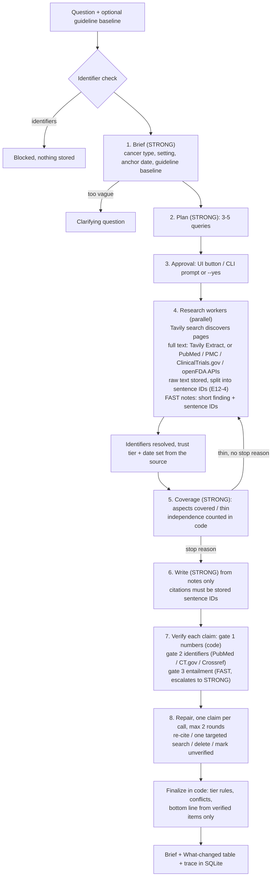

# Oncology Update Briefs — Research Agent

> ODSC × Nebius Hackathon submission · Challenge: _Build a research agent that brings its sources_

**One-line pitch:** For a practicing oncologist, "what has changed for this clinical question since my guideline version?" answered as a dated brief in which every claim quotes the exact stored sentences it rests on and passes three verification gates (numbers in code, PMID/NCT/DOI resolution, entailment) before it is shown as verified.

**Demo video (2–3 min):** <!--DEMO_LINK-->_link to be added_

**Team:** [@Gnana-Shishir-Kumar](https://github.com/Gnana-Shishir-Kumar) · [@pjsk02](https://github.com/pjsk02)

> **Clinician-support tool.** This brief summarizes published and public information to support a clinician's professional judgment and independent review. It is not for patients and does not give patient-specific recommendations. Use limits: clinician-facing only; not for patients; not for urgent or time-critical decisions; no patient data; page text only (figures, image tables and supplements are not read).

## The problem

Oncology changes faster than guidelines are reissued. Between versions, an oncologist needs to know what moved for one question (a new approval, a label change, a trial readout, a trial stopped, a guideline update) and needs to trust each item enough to act on it after checking the source. General search answers mix press releases with regulatory decisions, drop dates, and cite pages that do not say what the answer claims. PubMed-only tools miss regulatory and registry changes that never appear there.

This agent takes the question and the guideline baseline the clinician is working from (name, version, date; supplied by the user, never scraped), searches regulators, registries, guideline publishers, journals, conferences and news on or after that date, and returns a "What changed" table plus items that each quote their source sentences, show their trust tier and evidence level, and state which verification gates they passed. When the evidence is not there it says so instead of filling the gap.

## How it works

```
question (+ guideline baseline) → identifier check → brief → plan queries → [approval]
  → Tavily search (tier-filtered, since anchor date) → select & dedupe → full text (Tavily Extract, or PubMed/PMC,
    ClinicalTrials.gov, openFDA APIs) → stored as numbered sentences (E12-4) → FAST notes citing sentence IDs
  → coverage check → (follow-up round | stop reason) → STRONG writer (notes only, cites sentence IDs)
  → verifier: gate 1 numbers (code) → gate 2 identifiers (PubMed/CT.gov/Crossref) → gate 3 entailment (FAST → STRONG)
  → per-claim repair (max 2 rounds) → tier rules + conflict detection in code → brief with citations
```

- **Query planning:** the STRONG model writes a brief (cancer type, setting, anchor date, 2–6 aspects a complete answer must cover) and 3–5 queries. Round 1 searches tier 1–2 domains only (regulators, registries, guideline publishers, journals) at advanced depth from the anchor date; a coverage check (independence counted in code as distinct sites) asks for at most one follow-up per thin aspect, adding conference and news domains. Research stops with one of four printed reasons: `coverage_complete`, `no_new_evidence`, `quota_reached`, `time_budget`.
- **Evidence handling:** full page text is stored once per source and split into numbered sentences; workers see only the most relevant sentences with their IDs and return short notes citing them. The writer never sees page text. Every claim must cite stored sentence IDs; anything else (unknown IDs, invented URLs) is rejected in code. Each claim then passes three gates (details below), and failed claims are repaired one at a time: re-cite, one targeted search from a reserved quota, delete, or mark unverified. Trust tiers are assigned in code: a journal page counts as peer-reviewed only if its PMID/DOI resolves to the same title; an efficacy number resting only on press releases or news is tagged company-reported. Tier 1–2 sources that disagree are shown side by side.
- **Safety:** clinician-facing only, with the use limits above; an input check blocks patient identifiers before anything is stored; web text is wrapped as untrusted data and can never change instructions or trigger actions; NCCN is never accessed; practice-impact notes are labelled as interpretations; confidence is capped when evidence is preliminary or sources disagree; every step is traced in SQLite with model ID and prompt version.
- **Trade-offs:** verification costs time and tokens (about 12 minutes and 28 Tavily credits for a typical brief, most of it reasoning-heavy LLM calls); page text only, so figures and supplements are not read; deterministic checks are deliberately strict, so some true statements are flagged rather than any wrong number being shown as verified; news-only items are kept but shown as uncertain rather than dropped, because they are often the first signal of a change.

## Required services

| Service | Used for |
|---|---|
| **Nebius Token Factory** (inference) | all LLM calls. Model: STRONG `deepseek-ai/DeepSeek-V4-Pro-0813` (brief, planning, coverage, writing, repair), FAST `deepseek-ai/DeepSeek-V4.1-Flash-1017` (worker notes, entailment gate), via the OpenAI-compatible API |
| **Tavily** (real-time web search) | all discovery: `search` (explicit depth, `auto_parameters` off, domain and date filters) and `extract` (full page text); never `/research` |
| Additional ground-truth sources (free public APIs) | PubMed / PubMed Central, ClinicalTrials.gov v2, openFDA Drugs@FDA, Crossref: identifier resolution, source dates and registry/approval records for pages Tavily found |

## Setup

```bash
git clone https://github.com/Gnana-Shishir-Kumar/gauss-jordan.git && cd gauss-jordan
python -m venv .venv && source .venv/bin/activate      # Windows: .venv\Scripts\activate
pip install -r requirements.txt
cp .env.example .env                                   # set NEBIUS_API_KEY and TAVILY_API_KEY
python src/agent.py "What has changed for first-line EGFR-mutant metastatic NSCLC since 2024-06-01?" --yes
streamlit run app/streamlit_app.py                     # web UI
```

With [uv](https://docs.astral.sh/uv/): `uv sync`, then `uv run research "..."` and `uv run streamlit run app/streamlit_app.py`. `python scripts/list_models.py` confirms the model IDs exist on Token Factory. Keys are read only from the environment and never logged.

## Example

**Question:** What has changed for first-line treatment of metastatic EGFR-mutant non-small cell lung cancer since 2024-06-01? (baseline: ESMO metastatic NSCLC living guideline v1.1, stated by the user)

**Answer excerpt** (live run, 2026-11-18; a snapshot of public sources, not clinical guidance):

> **Bottom line:** Since June 2024, first-line amivantamab plus lazertinib gained FDA and European Commission approval for EGFR exon 19 deletion or L858R metastatic NSCLC with a VTE prophylaxis recommendation, while ASCO's living guideline reviewed RAMOSE and did not change its recommendation (confidence: moderate; key overall survival data are not yet fully published and some items come from news sources).
>
> | Change | Date | Evidence level | Tier | Review status | Verified |
> |---|---|---|---|---|---|
> | new approval | 2024-08-19 | regulatory decision | 1 | not peer-reviewed | yes |
> | safety communication | 2024-08-19 | regulatory decision | 1 | not peer-reviewed | yes |
> | new approval | 2025-12-17 | regulatory decision | 1 | not peer-reviewed | yes |
> | new trial data | 2026-02-02 | phase 2 randomized trial | 2 | peer-reviewed | yes |
>
> - On August 19, 2024, the FDA approved amivantamab plus lazertinib for first-line treatment of locally advanced or metastatic EGFR-mutant NSCLC with exon 19 deletions or exon 21 L858R substitution mutations [1]. *Checks: numbers pass · identifiers n/a · entailment supported.*
> - A serious VTE safety signal was observed with lazertinib plus amivantamab, and prophylactic anticoagulation should be given for the first four months of therapy [1].
> - The subcutaneous formulation (Rybrevant Faspro) was originally approved on 2025-12-17, with a supplement approved on 2026-11-05 [2].
> - The randomized phase II RAMOSE trial compared osimertinib with and without ramucirumab in TKI-naïve EGFR-mutant metastatic NSCLC [3].

**Sources** (each claim quotes its sentence by ID):

1. FDA, *FDA approves lazertinib with amivantamab-vmjw for non-small lung cancer*, https://www.fda.gov/drugs/resources-information-approved-drugs/fda-approves-lazertinib-amivantamab-vmjw-non-small-lung-cancer (tier 1). `E183-8`: "On August 19, 2024, the Food and Drug Administration approved lazertinib (Lazcluze, Janssen Biotech, Inc.) in combination with amivantamab-vmjw (Rybrevant, Janssen Biotech, Inc.) for the first-line treatment of locally advanced or metastatic non-small cell lung cancer (NSCLC) with epidermal growth factor receptor (EGFR) exon 19 deletions or exon 21 L858R substitution mutations, as detected by an FDA-approved test." `E183-19`: "A serious safety signal of venous thromboembolic events (VTE) was observed with lazertinib in combination with amivantamab and prophylactic anticoagulation should be administered for the first four months of therapy."
2. openFDA Drugs@FDA approval history for amivantamab, https://api.fda.gov/drug/drugsfda.json?search=openfda.generic_name:"amivantamab" (tier 1). `E186-11`: "RYBREVANT FASPRO (BLA761433) original approval ORIG-1 (type 5 - new formulation or new manufacturer) was approved on 2025-12-17." `E186-10`: "RYBREVANT FASPRO (BLA761433) supplement SUPPL-2 (efficacy) was approved on 2026-11-05."
3. *Signal Transduction and Targeted Therapy* (Nature), RAMOSE trial, https://www.nature.com/articles/s41392-025-02550-y (tier 2; DOI confirmed against Crossref).

The same brief also listed 8 developments that rest only on news or press releases (shown as uncertain), one efficacy number tagged *company-reported, not peer-reviewed*, and a preliminary conference abstract on VTE timing.

## Failure / insufficient-evidence case

**Question:** What has changed for the investigational agent TQX-9182 in second-line pleural mesothelioma since 2025-01-01? (TQX-9182 is a fictional drug code from the eval set; nothing about it exists.)

**What the agent did** (live run, 2026-11-19, `evals/results/20261119T220800Z-insuff.json`): three research rounds, 16 Tavily calls (stop reason `quota_reached`), 16 PubMed and 2 ClinicalTrials.gov lookups. It kept sources that matched the words "pleural mesothelioma", wrote notes about other agents, and then **refused to report anything**:

> **Status: insufficient_evidence**
>
> Insufficient evidence: No retrieved source addresses the investigational agent TQX-9182 or its use in second-line pleural mesothelioma. The available notes cover other mesothelioma agents or settings (pemetrexed-platinum after immunotherapy, VT3989, perioperative nivolumab/ipilimumab, DREAM3R durvalumab plus chemotherapy) and unrelated regulatory actions, so no TQX-9182 trial readouts, status changes, safety communications, approvals, label changes, guidelines, publications, or investigator updates since 2025-01-01 can be reported.
>
> **1. Bottom line:** No bottom line: the evidence found was insufficient. · **What changed:** No changes found.
>
> **Check before acting:** Search clinical trial registries, manufacturer disclosures, and conference abstract databases for TQX-9182-specific updates; confirm whether TQX-9182 has any public data or regulatory status after 2025-01-01.

No bottom line is produced without verified items, and the CLI exits with code 3. Other failure paths are handled the same way: a question with patient identifiers is blocked before anything is stored (exit 6); a question too vague to search returns one clarifying question (exit 4); claims whose numbers cannot be sourced are removed and listed under "Removed during verification"; a run that fails after research can be resumed (`--resume`).

## Judging criteria map

| Criterion | Weight | Where to look |
|---|---|---|
| Sourced and verifiable answers | 30% | [Example](#example), [The three verification gates](#the-three-verification-gates), [Seeded-error eval](#seeded-error-eval) |
| Works end to end | 25% | [Setup](#setup), demo, live runs in [Evals](#evals) |
| Usefulness | 20% | [The problem](#the-problem), the What-changed table, [Baseline comparison](#baseline-comparison-for-the-demo) |
| Agent design | 15% | [How it works](#how-it-works), [Architecture](#architecture), [Bounded repair loop](#bounded-repair-loop) |
| Use of Token Factory and Tavily | 10% | [Required services](#required-services), [Why Tavily discovers and structured APIs give ground truth](#why-tavily-discovers-and-structured-apis-give-ground-truth), [Token, cost and latency summary](#token-cost-and-latency-summary) |

## License

MIT — see [LICENSE](LICENSE).

---

# Details

## Run

```bash
# CLI: shows the brief and planned queries, asks to start (or pass --yes)
uv run research "What has changed for first-line EGFR-mutant metastatic NSCLC since 2024-06-01?"
uv run research "What changed for first-line EGFR-mutant NSCLC?" \
    --guideline "ESMO metastatic NSCLC living guideline" --guideline-version v1.1 --guideline-date 2024-06-01 --yes
uv run research --run 12          # approve a prepared task later
uv run research --resume 12       # re-run writing + verification for a task that failed after research
uv run research --show 12 --export ris --out sources.ris

# Web UI (guideline baseline fields under the question box)
uv run streamlit run app/streamlit_app.py
```

CLI exit codes: 0 done · 1 failed · 2 missing keys · 3 insufficient evidence · 4 needs clarification · 5 not approved · 6 identifiers detected.

**Tests and evals:**

```bash
uv run pytest                    # mocked tests, no network
uv run pytest -m live -s         # optional live smoke test
uv run python evals/run_evals.py # eval questions, live (--offset/--limit/--tavily-calls to shard and cap)
uv run python evals/compare.py   # drift gate against evals/baseline.json
uv run python evals/seeded_eval.py "evals/results/*shard*.db"   # seeded-error eval on stored briefs (no Tavily credits)
uv run python evals/baseline_compare.py --db research.db --task 2 # plain search+LLM baseline vs this pipeline
```

## Deploy to the cloud (container on a VM, e.g. Nebius AI Cloud)

One image runs the Streamlit UI. The same image has the `research` CLI, and both share one SQLite database on a persistent volume, so run history survives restarts and redeploys.

**1. Create a VM.**
- An Ubuntu CPU instance with a public IP and your SSH key is enough, because all inference runs on Token Factory.
- Open ports 22, 80 and 443.
- Install Docker Engine with the Compose plugin.

**2. Get the code and configure it.**
```bash
git clone https://github.com/Gnana-Shishir-Kumar/gauss-jordan.git && cd gauss-jordan
cp .env.example .env    # set NEBIUS_API_KEY, TAVILY_API_KEY, APP_PASSWORD (+ DOMAIN for HTTPS)
```
`APP_PASSWORD` is required: compose refuses to start the app without it. Keys are read from `.env` at runtime and are never put into the image.

**3. Start it.**
```bash
docker compose up -d --build                   # UI on the VM at 127.0.0.1:8501 only
docker compose --profile https up -d --build   # plus Caddy: https://$DOMAIN with an automatic certificate
```
- **Without a domain:** reach the UI through an SSH tunnel. Run `ssh -L 8501:localhost:8501 user@VM_IP`, then open http://localhost:8501.
- **With a domain:** point its DNS A record at the VM and use the `https` profile. Caddy terminates TLS and proxies to the app.
- **Either way,** the app asks for `APP_PASSWORD` once per browser session.

**4. Use the CLI on the VM** (same database as the UI, so `--show` works on runs started in the browser):
```bash
docker compose exec app python scripts/list_models.py
docker compose exec app research "What has changed for first-line EGFR-mutant metastatic NSCLC since 2024-06-01?"
docker compose exec app research --show 3 --export ris --out /data/task3.ris
docker compose cp app:/data/task3.ris .
```

**Operations:**
| Task | Command |
|---|---|
| Update | `git pull && docker compose up -d --build` |
| Logs | `docker compose logs -f app` |
| Back up history | `docker compose cp app:/data/research.db ./backup.db` |

The image runs as a non-root user and has a health check on `/_stcore/health`.

## Architecture



- **Engine** (`src/research_agent/engine/`): plain async functions, one per step (`brief`, `planner`, `research`, `coverage`, `writer`, `verifier`, `repair`), plus `numbers` (gate 1), `checks`, `conflicts`, `quota` and the `orchestrator` (`prepare()`, `run()`, `run_all()`, `resume()`). No UI code.
- **Backends** (`backends/`): `llm.py` (Token Factory via `AsyncOpenAI`), `tavily.py` (Tavily over `httpx`), `structured.py` (PubMed/PMC, ClinicalTrials.gov, openFDA, Crossref), `identifiers.py` (PMID/NCT/DOI resolution with a SQLite cache). All search backends implement the same `SearchBackend` protocol (`search()`, `extract()`).
- **Storage** (`storage.py`): SQLite, written after every step. Sources keep their raw text once; `sentences` holds the numbered sentences that every citation points to.

## Sentence-level evidence

1. A worker fetches a page's **full text** and stores it once per source. The text is split deterministically into numbered sentences. Within a brief a source is evidence `E12` and its sentences are `E12-1`, `E12-2`, ...
2. The worker (FAST model) sees only the 14 sentences most relevant to its query, each prefixed by its ID, inside a data-only `<untrusted_source>` block. It returns **compressed notes**: one short finding plus the sentence IDs it rests on. Code drops notes that cite IDs it was not shown, or that state numbers not in their cited sentences.
3. **Raw page text never enters the planner, coverage check or writer.** They see notes (finding + IDs) and trusted metadata (domain, tier, type, date).
4. The writer must end every claim with sentence IDs. **Code rejects** any claim citing an ID that is not in the store, a sentence index the page does not have, or a URL that is not one of the brief's sources, and sends it to repair. Fabricated references are closed in code, not by asking the model nicely.

Each source records URL, title, trust tier, source type, retrieval date, the date from the source itself (and where that date came from), and how its text was fetched.

## The three verification gates

Each claim runs through three gates in order. Each gate's result is stored separately on every citation (`number_gate`, `id_gate`, `entail_gate`), so the UI, the trace and the evals show *which* gate failed.

| Gate | How | Fails when |
|---|---|---|
| **1. Numbers** (code, no LLM) | Every number, unit, percentage, hazard ratio, confidence interval, p-value, date and sample size in the claim must appear in its cited sentences, verbatim or after normalization: `0.70` = `.70`, `1,024` = `1024`, `12 months` = `12-month`, `61%` = `61 percent`, `p<.001` = `P < 0.001`, `June 2025` matches `June 1, 2025`. Units must agree (12 months is not 12%), p-value comparators must agree (`p=0.001` is not `p<0.001`). | a quantity is not in the cited sentences, or a confidence interval is out of order (lower < point estimate < upper) |
| **2. Identifiers** | Every PMID, NCT number and DOI in the claim, and each cited source's own identifier, is resolved (PubMed E-utilities, ClinicalTrials.gov API v2, Crossref; cached in SQLite) and the resolved title must match the stored source. An identifier in the claim must also belong to a cited source. | the ID does not exist, resolves to a different title, or is not an ID of any cited source (a service outage is recorded as `error`, not a failure) |
| **3. Entailment** (FAST model, escalates to STRONG) | The judge sees **only** the claim and its cited sentences, plus one neighbouring sentence on each side marked *context*. It is told that support may come from the **combination** of several cited sentences. Verdict: `supported`, `partial` or `unsupported`. Escalation: the STRONG model re-judges when the FAST call fails or returns invalid output, and when FAST says `partial` on a claim with numbers. | `partial` or `unsupported` |

Gate 1 fails fast: a claim with an unsourced number never costs an LLM call.

### Worked example (from a live brief)

Stored source `E183` is the FDA's approval page. Its sentence `E183-8` reads: *"On August 19, 2024, the Food and Drug Administration approved lazertinib … in combination with amivantamab-vmjw … for the first-line treatment of locally advanced or metastatic non-small cell lung cancer …"*. Another claim in the same brief (EVEREST trial, PubMed 39389055) states *"median PFS was 9.6 months"*.

- **Wrong number.** The seeded eval changed the claim to *"median PFS was 10.7 months"*. Gate 1: `'10.7' (number month) not found in the cited sentences` → **unsupported**, no LLM call. Repair then re-cited or removed the claim; a number that cannot be sourced from stored evidence is never kept.
- **Number from the wrong arm.** Changing the drug arm's value to the comparator arm's (e.g. *"PFS 16.6 months with amivantamab plus lazertinib"* when the sentence gives 23.7 vs 16.6) passes gate 1, because 16.6 *is* in the sentence. Gate 3 is what catches it: the judge reads both arms and returns **unsupported**.
- **Fabricated reference.** Appending *"(PMID 99999999)"* fails gate 2: PubMed has no such record.
- **Swapped citation.** Citing the venous-thromboembolism sentences for the approval claim fails gate 1 (the date is not in those sentences) or gate 3 (they say nothing about an approval).

## Bounded repair loop

Failed claims are repaired **one claim per call**, never by rewriting the brief. Each round (max 2):

1. If gate 1 failed, **code** first looks for stored sentences of this brief that contain every number in the claim and re-cites to them (no LLM call).
2. Otherwise the STRONG model picks one action for that claim alone: **re-cite** from existing notes (optionally correcting the text), run **one targeted search** from the reserved Tavily quota, **delete** the claim, or mark it **unverified**.
3. Revised claims go through all three gates again.

After the last round, a claim still failing gate 1 is **deleted** (a number that cannot be sourced is removed, never invented) and any other failing claim is kept but marked **unverified** and uncertain. Deleted claims are listed under "Removed during verification".

## Trust tiers (enforced in code)

| Tier | What | Rule |
|---|---|---|
| 1 | FDA, EMA, ClinicalTrials.gov, guideline publications (ESMO, ASCO; NCCN only as the user's stated baseline) | regulator, registry and guideline source types |
| 2 | Peer-reviewed journals | **only if the article's PMID or DOI resolves to the same title**; a journal page whose identifier cannot be confirmed drops to tier 4 |
| 3 | Conference abstracts, preprints | always labelled **PRELIMINARY** |
| 4 | Press releases, news | a tier 4 source can **never be the only support for an efficacy number**: such a claim is tagged **company-reported, not peer-reviewed** and its claim type set to `uncertain`; any claim resting only on tier 4 is uncertain |

- Search domains are grouped by the tier their pages usually get; round 1 searches tiers 1–2 only (Tavily `include_domains`, strict), follow-up rounds add conference hosts and news. The actual tier is assigned after fetching, from the source type and the identifier check.
- **NCCN is never searched or fetched** (its terms prohibit automated access). The user supplies the guideline name, version and date; values the model extracts are kept only if the user wrote them. Login-gated pages are recorded as `source_unavailable`.
- The bottom line is capped at **low** without a supported tier 1–2, non-preliminary finding, and at **moderate** when items are flagged or sources disagree.

## Why Tavily discovers and structured APIs give ground truth

Tavily is the only discovery engine: it finds the regulatory pages, guideline and journal articles, conference abstracts and news that matter for "what changed", across many sites, filtered by date. The structured APIs are used only to **check and ground** what Tavily found:

- **PubMed / PubMed Central:** a PubMed URL is read as the PubMed record (title, journal, publication date, abstract); open-access articles as PMC full text. A journal page Tavily cannot extract falls back to PMC full text, then is recorded as a coverage gap.
- **ClinicalTrials.gov API v2:** a registry URL is read as the record: status, phase, start/completion dates, last update posted, whether results are posted.
- **openFDA (Drugs@FDA):** an FDA approval page is paired with the approval history of the drugs it names (original approvals and supplements with dates), as its own tier 1 evidence.
- **Crossref:** DOI resolution for gate 2 and tier 2 confirmation.
- **Dates come from the source:** PubMed publication date, ClinicalTrials.gov last update posted, Drugs@FDA approval dates, Crossref published date. Tavily's `published_date` is kept only as a hint.

Each API has its own call cap and rate spacing (NCBI: 3 requests/s, or 10/s with `NCBI_API_KEY`). No dependency beyond `httpx`.

## Searching, quotas and stop reasons

- **Tavily settings everywhere:** `search_depth` set explicitly and `auto_parameters` off (cost never silently doubles); evidence searches at advanced depth with `chunks_per_source=3`; `include_answer` and `include_raw_content` off (we verify only against fetched page text, never Tavily's answer or snippets); Extract returns full text (no query chunking) and its `failed_results` are read even on HTTP 200, retried once with advanced extraction, then PMC, then recorded as a gap; concurrency semaphore of 5; 429s honour `Retry-After` with backoff; the `/research` endpoint is never used.
- **Quotas per brief:** one pooled Tavily budget of **40 calls** (every search and every extract call counts one), of which **8 are reserved for repair**; separate caps for PubMed (60), ClinicalTrials.gov (40), openFDA (20) and Crossref (40). Usage is stored on the task and shown in the report.
- **Stop reasons** (every stop prints its reason and why):

  | Stop reason | When |
  |---|---|
  | `coverage_complete` | every aspect has ≥2 independent sources (distinct sites, counted in code) |
  | `no_new_evidence` | two consecutive rounds added no new sentence IDs, or nothing is left to search (no new follow-up queries, or the coverage check failed) |
  | `quota_reached` | the research share of the Tavily quota is spent, or the 4-round safety cap is reached |
  | `time_budget` | the 420 s research time budget is spent |

- **Resilience:** a writer call that hits a transient error is retried after 15 s and 45 s; a run that still fails after research can be resumed with `research --resume ID` without new research calls.

## Context and cost efficiency

- Every prompt is **fixed instructions first, changing content last**: system prompts are module constants (byte-identical across calls of the same step; even today's date moved into the user message), so cached input pricing applies. Nebius reports cached tokens, and the report shows the cached share per step.
- Fetched text only appears inside data-only `<untrusted_source>` blocks; page content can never choose tools, change instructions or trigger actions.
- Every report ends with a **cost by step** table (LLM calls, input and output tokens, cached share, Tavily credits, seconds), also in the UI trace.

## Safety and governance

| Concern | What addresses it |
|---|---|
| **Hallucination detection** | Citations must be stored sentence IDs (checked in code); three verification gates per claim; per-claim repair with deletion of unsourceable numbers; unverified claims shown as UNVERIFIED or FLAGGED; `insufficient_evidence` when nothing holds up; seeded-error eval measures it. |
| **Explainability** | Every claim quotes its cited sentences verbatim by ID; each gate's result is shown; tier, peer-reviewed / PRELIMINARY / COMPANY-REPORTED label and the stop reason are on every brief. |
| **Clinical safety** | Clinician-facing statement and use limits in the UI, CLI and README; no patient-specific recommendations; tier 4-only efficacy numbers tagged company-reported and uncertain; conflicts shown side by side; confidence caps; practice-impact notes labelled as interpretations. |
| **Privacy** | No patient data. An input check blocks MRN-like numbers, dates of birth and patient names before anything is stored. Keys come only from the environment and are never logged. A contact e-mail is sent to NCBI/Crossref only if you set one. |
| **Auditability** | SQLite trace after every step: sub-queries, every source (fetched raw text, sentences, how it was fetched, why dropped), notes, claims, each gate's result, repair actions, API calls, tokens, cached tokens, credits and latency. Model ID and prompt version on every task and event. CSV and RIS exports. |
| **Drift** | `PROMPT_VERSION` on every task and event. `evals/compare.py` fails if citation support rate or number-check pass rate drops by more than 3 points against the baseline; seeded-eval results are saved per run for comparison. |
| **Evidence-population bias** | Population shown per item only when a cited sentence states it; otherwise "population not stated". |

**Why the design follows FDA's non-device CDS principles** (21st Century Cures Act §520(o)(1)(E); FDA CDS guidance, 2022): no image or signal analysis; published information only; clinician-facing and not for time-critical decisions; a transparent basis the clinician can review independently (every claim quotes its sentences, every gate result is shown). **This is a design rationale, not a regulatory determination.**

## Exports

From the UI or `--export csv|ris`: **CSV** (evidence IDs, title, URL, domain, source type, date, trust tier, verdicts) and **RIS** for Zotero or EndNote (`TY` by source type, `TI`, `UR`, `PY`/`DA`, `KW` with type and tier). Standard library only.

## Evals

### Seeded-error eval

`evals/seeded_eval.py` takes briefs that already ran (their stored sources, sentences, notes and verified claims) and, for every verified claim, builds a clean **control** copy plus corrupted copies with one injected error each:

| Error type | Injection |
|---|---|
| `wrong_number` | one number changed (e.g. 9.6 → 10.7 months) |
| `swapped_citation` | the claim cites another claim's sentences from a different source |
| `fabricated_id` | a PMID or NCT number that does not exist is added |
| `stale_date` | an approval date two years before the anchor is put in the claim |
| `tier4_only_efficacy` | an efficacy claim's support is re-labelled as a press release |
| `number_from_other_arm` | (harder, extra) a number replaced by **another number from the same cited sentences**, e.g. the comparator arm's value; gate 1 passes by design, only entailment can catch it |

Every copy goes through the real gates (live FAST model for entailment, live PubMed/ClinicalTrials.gov/Crossref), then the repair loop (targeted searches disabled, so no Tavily credits), then the tier rules. It reports precision and recall per error type and per gate, the false-positive rate on clean claims, citation support before and after repair, how many corrupted claims would still be shown as verified, and each brief's credits, tokens and seconds. Results are saved per run as `evals/results/seeded-<stamp>.json`.

Live run on 2026-11-19 over the 12 eval briefs above (`evals/results/seeded-20261119T220931Z.json`): 5 verified claims sampled per brief, repair run on the first 3 briefs (repair makes one STRONG call per failed claim; precision and recall use every brief).

12 briefs, 60 clean claims, 237 seeded errors. Overall precision 100.0%, recall 99.6%, false-positive rate on clean claims 0.0%.

| Error type | Cases | Caught | Recall | Caught by | Error still shown as verified after repair* |
|---|---|---|---|---|---|
| wrong_number | 29 | 28 | 96.6% | numbers 26, entailment 2 | 0 of 8 |
| swapped_citation | 60 | 60 | 100.0% | numbers 45, entailment 15 | 0 of 15 |
| fabricated_id | 60 | 60 | 100.0% | identifiers 60 | 0 of 15 |
| stale_date | 60 | 60 | 100.0% | numbers 60 | 0 of 15 |
| tier4_only_efficacy | 16 | 16 | 100.0% | tier_rule 16 | 0 of 5 |
| number_from_other_arm | 12 | 12 | 100.0% | entailment 8, numbers 4 | 0 of 2 |

| Gate | Flags on seeded errors | Flags on clean claims | Precision |
|---|---|---|---|
| citation | 0 | 0 | n/a |
| numbers | 135 | 0 | 100.0% |
| identifiers | 60 | 0 | 100.0% |
| entailment | 25 | 0 | 100.0% |
| tier_rule | 16 | 0 | 100.0% |

Repair ran on 3 briefs (75 cases). Citation support rate on those cases: 26.7% before repair, 100.0% shown as verified after repair; clean claims still verified after repair: 100.0%.
*Counted on the briefs where repair ran: a seeded error 'leaks' only if it is still in the claim and the claim is shown as verified without the label that flags it. Leaks: 0 of 60; the rest were corrected, removed or marked unverified by repair.
Per brief (original run): 21.7 Tavily credits, 38953.0 input / 57620.6 output tokens, 741.5 s.

Notes, honestly:
- **The one miss** was partly an injector bug: meant to change the "2" in "2-5 cm", it changed "HER2-negative" to "HER5-negative". Gate 1 ignores gene and drug names by design, and the entailment judge accepted the changed biomarker name. The injector is fixed; a changed biomarker name is a real blind spot to keep testing.
- **Most seeded errors are mechanical**, so gate 1 catches them without an LLM call; the harder `number_from_other_arm` cases (a value that does appear in the cited sentences, e.g. the comparator arm's) are where entailment does the work (8 of 12; the other 4 broke confidence-interval ordering, which gate 1 checks).
- **Repair** turned 26.7% supported (only the clean controls and tier-4 cases) into 100% verified on the repaired briefs **without keeping any seeded error**: wrong numbers were re-cited to the sentences with the right values, fake PMIDs/NCTs and stale dates were dropped from the text, swapped citations re-cited.
- On the live briefs themselves (not seeded), the repair loop ran 8 times and all 8 claims passed every gate afterwards (see below).

### Live eval questions and drift gate

`evals/questions.jsonl` holds 15 "what's changed" questions across 12 cancer types (three use fictional drug codes and should end `insufficient_evidence`). `evals/run_evals.py` runs them live into a fresh database and saves `evals/results/<stamp>.json` with citation support rate, number-check pass rate, tier 1–2 support share, preliminary-label share, insufficient-evidence accuracy, and average credits, latency and tokens. `evals/compare.py` exits 1 if a gated metric drops by more than 3 points against `evals/baseline.json` (`--set-baseline` accepts a run).

Live run on 2026-11-19: the 12 answerable questions (11 cancer types), each capped at 20 Tavily calls (4 reserved for repair), run as three parallel shards. Results: `evals/results/20261119T204445Z-shard{0,4,8}.json`.

| Metric | Result |
|---|---|
| Briefs finished `done` | **12 / 12** |
| Claims written / shown as verified | 137 / 137 (none deleted, none left unverified) |
| First-pass gate failures | 8 (5 number gate, 3 entailment), **all fixed by the repair loop** (8 re-cites) |
| Number-check pass rate (first pass) | 95.5% |
| Citation support rate (final) | 100% |
| Tier 1–2 support share | 64.2% of verified claims rest on a tier 1–2 source |
| Efficacy numbers tagged company-reported (tier 4 only) | 15 |
| Kept sources by tier | 56 tier 1 · 55 tier 2 · 2 tier 3 · 76 tier 4 |
| Stop reasons | 5 `quota_reached`, 4 `time_budget`, 2 `coverage_complete`, 1 `no_new_evidence` |
| Average per brief | **21.7 Tavily credits**, 38,953 input / 57,621 output tokens, 742 s (median about 9 min; one brief took 51 min because of slow LLM calls) |

The drift gate (`evals/compare.py`) gates citation support rate and number-check pass rate; set this run as the baseline with `--set-baseline --latest <file>`.

### Baseline comparison (for the demo)

`evals/baseline_compare.py` runs one question through a plain baseline (**one** Tavily search + **one** LLM answer, no verification) and puts every baseline claim through this project's checks: claims citing URLs that were not in the search results are rejected, the cited page is fetched and split into sentences, and the three gates and tier rules run unchanged. It prints which baseline claims would be flagged next to the pipeline's own result for the same question.

Live result (2026-11-19) for the EGFR NSCLC question, pipeline side = the stored run above:

**Baseline** (1 search + 1 LLM answer, no checks): 5 claims. Through this project's checks: **0 fail a verifier gate**, **4 rest only on news or press releases** (would be shown as uncertain), 1 pass. 3 Tavily credits.

| Baseline claim | Gates | Source tier | Outcome here | Cited URL |
|---|---|---|---|---|
| Amivantamab plus lazertinib was FDA approved for first-line treatment of locally advanced or metastatic NSCLC harboring EGFR exon 19 deletions or exon 21 L858R mutations based on the phase 3 MARIPOSA trial. | numbers n/a · identifiers n/a · entailment supported | 4 | shown as uncertain: supported only by tier 4 sources (press release / news) | https://targetedonc.com/view/polling-data-show-updates-in-treatment-of-mnsclc-with-egfr-mutations |
| In MARIPOSA, amivantamab plus lazertinib showed a 7.1-month improvement in median progression-free survival and a 30% reduction in the risk of progression or death compared with osimertinib. | numbers pass · identifiers n/a · entailment supported | 4 | shown as uncertain: efficacy number supported only by tier 4 sources (press release / news): company-reported | https://targetedonc.com/view/polling-data-show-updates-in-treatment-of-mnsclc-with-egfr-mutations |
| Overall survival improvements in both FLAURA2 and MARIPOSA have changed practice and made combination strategies the first-line therapy for most patients with EGFR-mutated NSCLC. | numbers n/a · identifiers n/a · entailment supported | 4 | shown as uncertain: supported only by tier 4 sources (press release / news) | https://oncologynewscentral.com/nsclc/as-practice-changing-data-hit-egfr-mutated-nsclc-care-whats-next |
| Osimertinib monotherapy remains an option in older, fragile patients and those with good prognostic features such as absence of EGFR mutation in plasma and TP53 wild-type status because it provides the best safety profile. | numbers n/a · identifiers pass · entailment supported | 2 | verified | https://pmc.ncbi.nlm.nih.gov/articles/PMC12963156 |
| The NorthStar trial showed that adding local consolidation therapy, whether radiation or in some cases surgery, to first-line osimertinib monotherapy seemed to improve progression-free survival in EGFR-mutated lung cancer. | numbers n/a · identifiers n/a · entailment supported | 4 | shown as uncertain: supported only by tier 4 sources (press release / news) | https://oncologynewscentral.com/nsclc/as-practice-changing-data-hit-egfr-mutated-nsclc-care-whats-next |

**This pipeline** (task 2, done): 13 claims written, 13 pass every gate (5 backed by tier 1-3 sources, 8 news-only and shown as uncertain), 0 removed or marked unverified by repair; 28 Tavily credits.

What this shows, honestly: the baseline's claims were mostly *accurate to their pages*: none failed a verifier gate. The difference is **what they rest on**: 4 of 5 came only from news sites, so here they would be shown as uncertain (one efficacy number as company-reported), while the pipeline grounds its findings in FDA, Drugs@FDA and PubMed-confirmed sources, quotes the exact sentences, and shows the evidence level, tier and date for each change. The baseline's output varies run to run; rerun the script for a fresh sample.

## Token, cost and latency summary

Measured live on 2026-11-18 (first-line EGFR-mutant metastatic NSCLC since 2024-06-01, ESMO baseline, default settings, empty cache; `research --show` prints this table for any run):

| Step | LLM calls | Input tokens | Output tokens | Cached share | Tavily credits | Seconds |
|---|---|---|---|---|---|---|
| brief | 1 | 516 | 294 | n/r | 0 | 2.7 |
| plan | 1 | 303 | 620 | n/r | 0 | 4.2 |
| search (12 Tavily searches, advanced) | 0 | 0 | 0 | | 24 | 48.8 (summed per call) |
| extract (Tavily batches + openFDA) | 0 | 0 | 0 | | 4 | 25.0 |
| notes (FAST) | 10 | 21,003 | 33,137 | 17% | 0 | 209.9 |
| coverage (STRONG) | 3 | 13,918 | 45,272 | 24% | 0 | 261.4 |
| write (STRONG) | 1 | 4,044 | 10,027 | n/r | 0 | 58.1 |
| verify (FAST, gate 3) | 13 | 9,711 | 1,787 | 25% | 0 | 17.4 |
| **total** | 29 | 49,495 | 91,137 | 9,344 cached | **28** | about 12 min wall clock |

Calls against the quotas: Tavily 16 of 40 (none of the 8 repair calls needed), openFDA 2, Crossref 3. "n/r" means the API did not report cached tokens for that call.

- **Where time goes:** these models write long reasoning before their JSON, so the coverage check and worker notes dominate (one notes call produced 18,000 output tokens in 125 s). Research stops on the 420 s `time_budget` in practice; verification is fast (about 1 s per claim).
- **Where credits go:** evidence searches run at advanced depth (2 credits each) by design; Extract is 1 credit per 5 pages; PubMed, ClinicalTrials.gov, openFDA and Crossref cost no Tavily credits.
- **Cache:** searches (exact query + parameters) and fetched page text are reused for 7 days at 0 credits.
- `evals/credit_comparison.py` prices a stored run's own queries against "fetch every result" strategies.

## Models and integration setup

| Tier | Default | Used for |
|---|---|---|
| STRONG | `deepseek-ai/DeepSeek-V4-Pro-0813` | brief, planner, coverage, writer, repair; entailment escalation |
| FAST | `deepseek-ai/DeepSeek-V4.1-Flash-1017` | worker notes, entailment (gate 3) |

Confirmed on Token Factory with `scripts/list_models.py`; both are configurable (`RESEARCH_STRONG_MODEL`, `RESEARCH_FAST_MODEL`). Rerun the evals and the drift gate after changing either.

- **Token Factory:** `AsyncOpenAI(base_url="https://api.tokenfactory.nebius.com/v1")`, JSON mode with a prompt-only fallback, Pydantic validation with one corrective retry, then safe fallbacks (brief → the question; plan → the question as the only query; notes → worker skipped; coverage → stop `no_new_evidence`; entailment → STRONG, then `unsupported`). Up to 16,384 output tokens and 480 s per call (these models reason at length before their JSON).
- **Retries:** SDK retries off; `retry.py` applies exponential backoff with jitter to timeouts, connection errors, 429 (honouring `Retry-After`, capped at 60 s) and 5xx, for every service.
- **Storage:** SQLite schema v4 (`PRAGMA user_version = 4`): `sources.raw_text`, `sentences`, gate columns on `claim_citations`, claim status/verdict/labels/repair log/change type/impact, `id_cache`, `trace_events.cached_tokens`. Older databases are refused with a clear message rather than silently migrated.
